# 📄 Resume Screener AI — ML System

[](https://github.com/narendrakalam2001/resume-screener-ai-mlops/actions)
[](https://python.org)
[](https://fastapi.tiangolo.com)
[](https://streamlit.io)
[](https://lightgbm.readthedocs.io)
[](https://docker.com)
[](https://mlflow.org)
[](LICENSE)

> **Domain:** HR Tech / Recruitment  
> **Problem:** Multi-class Text Classification + Semantic Resume Ranking  
> **Dataset:** [Kaggle Resume Dataset — 2,482 resumes · 24 categories](https://www.kaggle.com/datasets/snehaanbhawal/resume-dataset)  
> **Industry Context:** Naukri.com · Darwinbox · Workday-equivalent AI screener — reduces recruiter screening time by **60–70%**

---

## 💡 Why This Project Matters

Recruiters at companies like Naukri.com and Darwinbox don't manually read thousands of resumes —
they rely on ATS (Applicant Tracking Systems) that automatically screen and rank candidates
before any human sees them. This system simulates that exact workflow:

- A **TF-IDF + LightGBM classifier** predicts the most likely job category for each resume
- A **Match Engine** then applies business rules on top of ML score — keyword overlap with JD,
  experience years detection — to produce a final SHORTLIST / REVIEW / REJECT decision
- The **Match Engine runs after** the ML score, not before — mirroring how real ATS platforms
  combine ML ranking with rule-based filters (minimum skills, required years of experience)
- Every model promotion goes through a **3-gate Champion-Challenger** check — no model reaches
  production without demonstrably better F1 and generalization than the current champion

This ensures recruiters only spend time on pre-qualified candidates, reducing screening
time by **60–70%** — the industry benchmark at Naukri.com scale.

---

## 🏆 Champion Model Results

| Metric | Score |
|---|---|
| **F1 Macro** | `0.7608` |
| **F1 Weighted** | `0.7982` |
| **Test Accuracy** | `0.8068` |
| **Top-3 Accuracy** | `0.9416` |
| **ROC-AUC (OvR)** | `0.9793` |
| **Train-Test Gap** | `0.1932` |
| **CV F1 Mean (5-fold)** | `0.7110` |
| **Recruiter Hours Saved / 1K** | `~75 hours` |
| **Cost Saved / 1K resumes** | `~$1,878 USD` |
| **Automation Coverage** | `56.3%` |

---

## 🔗 Live Links

| Service | URL |
|---|---|
| 🚀 **FastAPI (Swagger UI)** | [https://resume-screener-ai-mlops.onrender.com/docs](https://resume-screener-ai-mlops.onrender.com/docs) |
| 📊 **Monitoring Dashboard** | [https://resume-screener-dashboard.streamlit.app](https://resume-screener-ai-mlops.streamlit.app) |
| 📓 **EDA Notebook** | [notebooks/resume_screener_eda.ipynb](notebooks/resume_screener_eda.ipynb) |

> ⚠️ Render free tier: first request may take 30–60 seconds (cold start).

---

## 🏗️ System Architecture

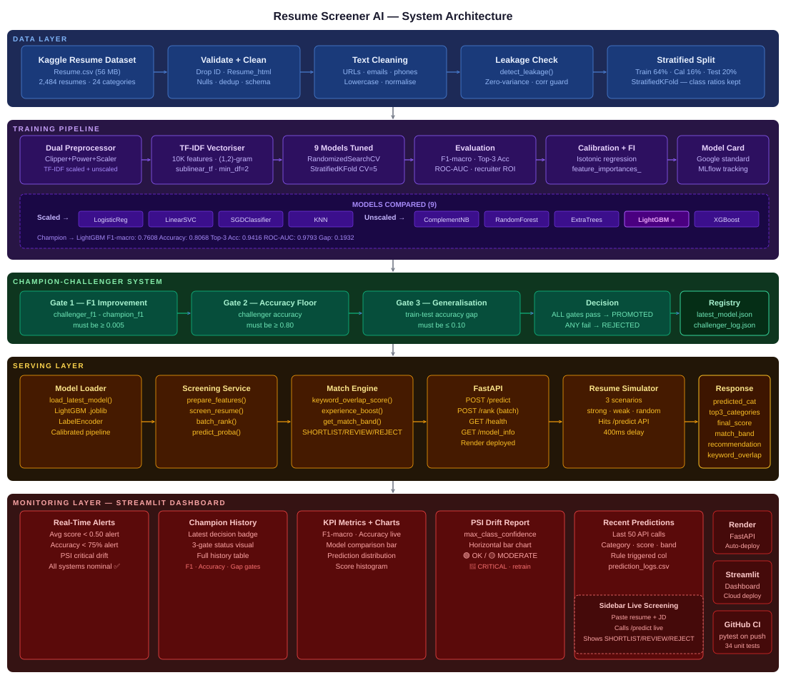

```
╔══════════════════════════════════════════════════════════════════════════════════╗
║              RESUME SCREENER AI — 5-LAYER PRODUCTION SYSTEM                      ║
╠══════════════════════════════════════════════════════════════════════════════════╣
║                                                                                  ║
║  ┌─────────────────────────────── DATA LAYER ──────────────────────────────┐     ║
║  │  Kaggle CSV  →  Validate + Clean  →  Text Normalise  →  Leakage Check   │     ║
║  │  2,482 resumes · 24 ALL-CAPS categories · Stratified Split 64/16/20%    │     ║
║  └───────────────────────────────────┬─────────────────────────────────────┘     ║
║                                      ▼                                           ║
║  ┌─────────────────────────── TRAINING PIPELINE ───────────────────────────┐     ║
║  │                                                                         │     ║
║  │  ┌──────────────────┐    ┌───────────────┐    ┌──────────────────────┐  │     ║
║  │  │  Dual TF-IDF     │    │  9 Models     │    │  Evaluation          │  │     ║
║  │  │  Preprocessor    │───▶│  Tuned via    │───▶│  F1-macro · Top-3   │  │     ║
║  │  │  Clipper+Scale   │    │  RandomSearch │    │  ROC-AUC · Gap       │  │     ║
║  │  │  scaled+unscaled │    │  StratifiedCV │    │  Isotonic Calib.     │  │     ║
║  │  └──────────────────┘    └───────────────┘    └──────────────────────┘  │     ║
║  │                                                                         │     ║
║  │  LogReg · LinearSVC · SGD · ComplementNB · KNN (scaled)                 │     ║
║  │  ComplementNB · RF · ExtraTrees · XGBoost · LightGBM ⭐ (unscaled)     │     ║
║  │                                                                         │     ║
║  │  CHAMPION → LightGBM  F1=0.7608  Acc=0.8068  Top3=0.9416                │     ║
║  └───────────────────────────────────┬─────────────────────────────────────┘     ║
║                                      ▼                                           ║
║  ┌──────────────────────── CHAMPION-CHALLENGER ────────────────────────────┐     ║
║  │                                                                         │     ║
║  │  Gate 1: F1 improvement   ≥ 0.005  →  ✅ PASS / ❌ FAIL                │     ║
║  │  Gate 2: Test accuracy    ≥ 0.80   →  ✅ PASS / ❌ FAIL                │     ║
║  │  Gate 3: Train-test gap   ≤ 0.10   →  ✅ PASS / ❌ FAIL                │     ║
║  │                                                                         │     ║
║  │  ALL gates pass → PROMOTED (latest_model.json updated)                  │     ║
║  │  ANY gate fails → REJECTED (champion retained, result logged)           │     ║
║  └───────────────────────────────────┬─────────────────────────────────────┘     ║
║                                      ▼                                           ║
║  ┌──────────────────────────── SERVING LAYER ──────────────────────────────┐     ║
║  │                                                                         │     ║
║  │  Model Loader  →  Screening Service  →  Match Engine  →  FastAPI        │     ║
║  │                                                                         │     ║
║  │  POST /predict → single resume screen       (→ SHORTLIST/REVIEW/REJECT) │     ║
║  │  POST /rank   → batch rank top-K candidates (→ ranked list)             │     ║
║  │  GET  /health  → API health check           (→ {status, model_loaded})  │     ║
║  │  GET  /model_info → champion model card     (→ metrics + biz impact)    │     ║
║  │                                                                         │     ║
║  │  Match Engine:  ML Score → Keyword Overlap → Experience Boost           │     ║
║  │                 → STRONG (≥0.70) / MODERATE (0.40–0.70) / WEAK (<0.40)  │     ║
║  │                 → SHORTLIST          / REVIEW              / REJECT     │     ║
║  └───────────────────────────────────┬─────────────────────────────────────┘     ║
║                                      ▼                                           ║
║  ┌─────────────────── MONITORING LAYER — STREAMLIT DASHBOARD ──────────────┐     ║
║  │                                                                         │     ║
║  │  Section 1: Real-Time Alerts     → score drop · accuracy drop · PSI     │     ║
║  │  Section 2: Champion-Challenger  → decision · 3-gate status · history   │     ║
║  │  Section 3: KPIs + Charts        → F1 · Accuracy · Top-3 · model bar    │     ║
║  │  Section 4: PSI Drift            → max_class_confidence PSI=0.1132      │     ║
║  │  Section 5: Recent Predictions   → audit log · category · band · rule   │     ║
║  │  Sidebar:   Live Screening       → paste resume+JD → instant decision   │     ║
║  │                                                                         │     ║
║  │  Simulator: 3 scenarios (strong · weak · random) → hits /predict API    │     ║
║  └─────────────────────────────────────────────────────────────────────────┘     ║
╚══════════════════════════════════════════════════════════════════════════════════╝
```

---

## 📸 Dashboard Screenshots

### 🖥️ Full Dashboard UI

Real-time resume screening dashboard — Champion-Challenger system · KPI cards · PSI drift · prediction audit log · live sidebar screener.

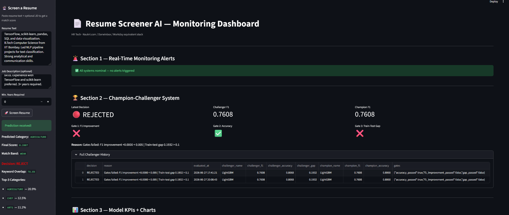

---

### 📊 Model KPIs

F1-macro · Test Accuracy · Top-3 Accuracy · ROC-AUC (OvR) metric cards with model comparison bar chart across all 9 models.

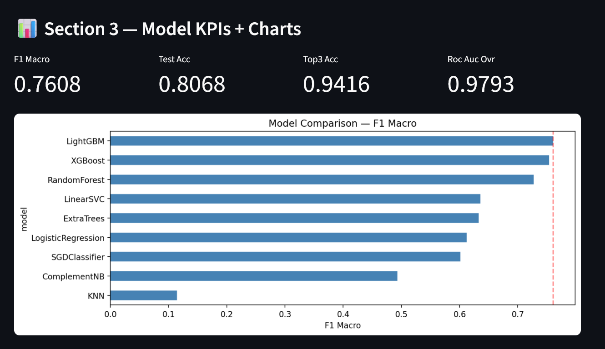

---

### 📉 PSI Drift Monitoring

`max_class_confidence` PSI = 0.1132 (MODERATE) — colour-coded bar chart with stable/moderate/high thresholds at 0.10 and 0.20.

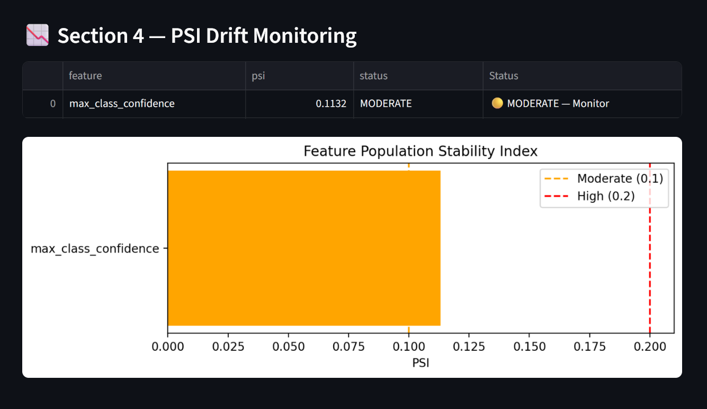

---

### 🔍 Recent Predictions Log

Live prediction audit log — predicted category · final score · match band · recommendation · rule triggered per resume.

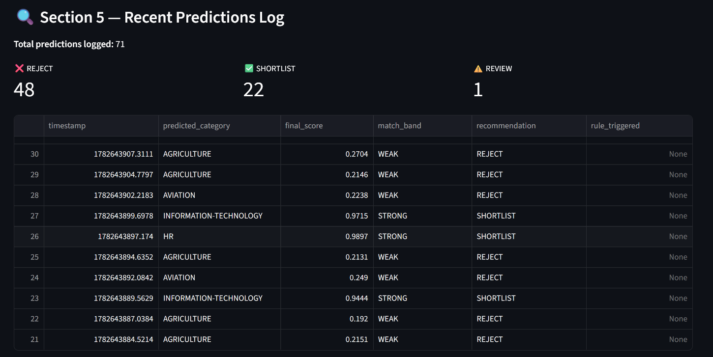

---

### 📈 Match Score Distribution

Histogram of final match scores across all screened resumes — shows SHORTLIST / REVIEW / REJECT band boundaries.

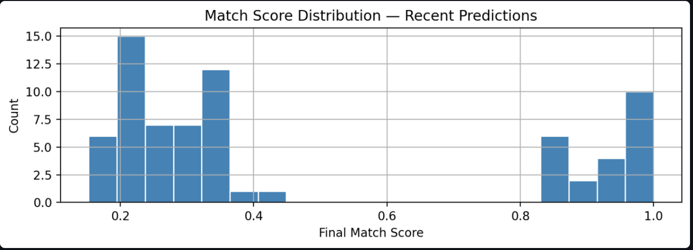

---

## 📊 Training Reports

| Model Comparison | Confusion Matrix |
|---|---|
| 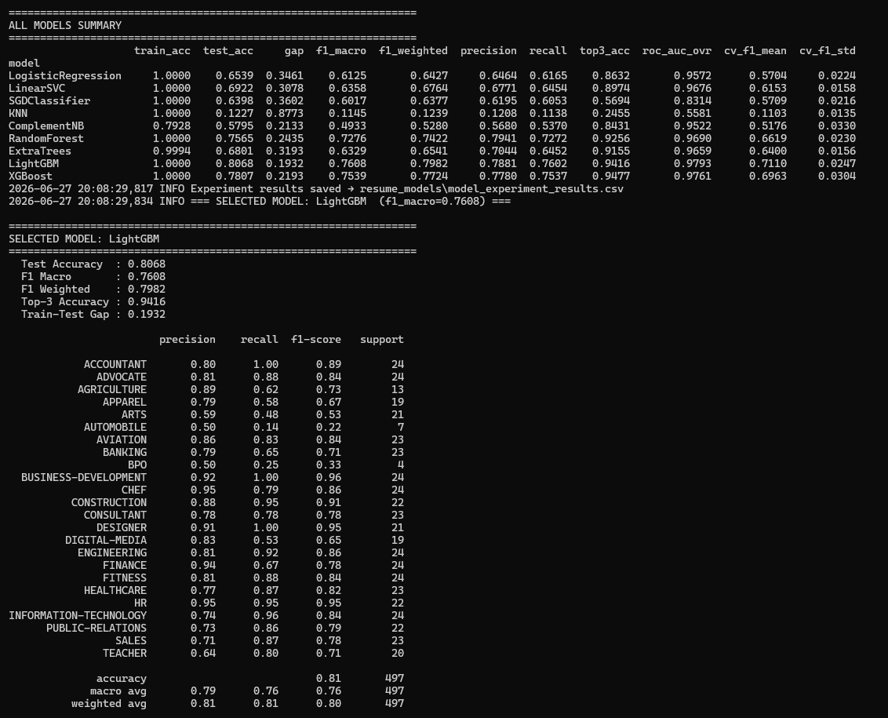 | 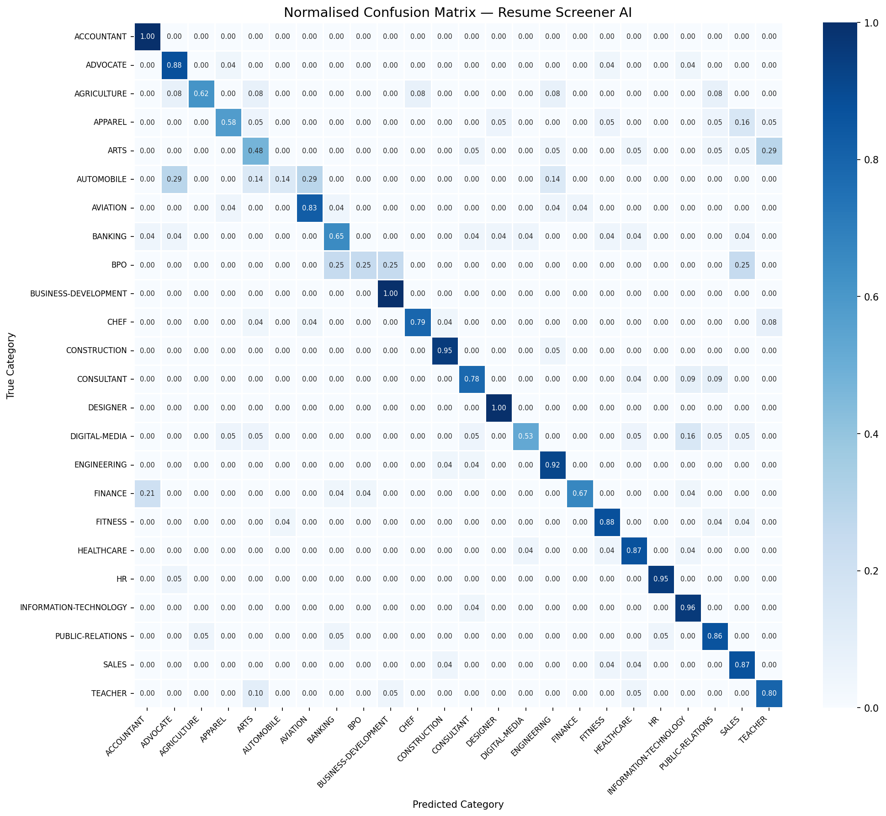 |

| Champion-Challenger | Test Coverage |
|---|---|
| 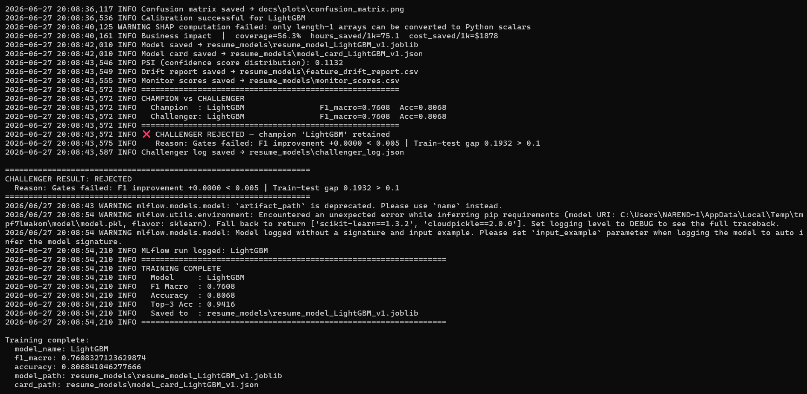 | 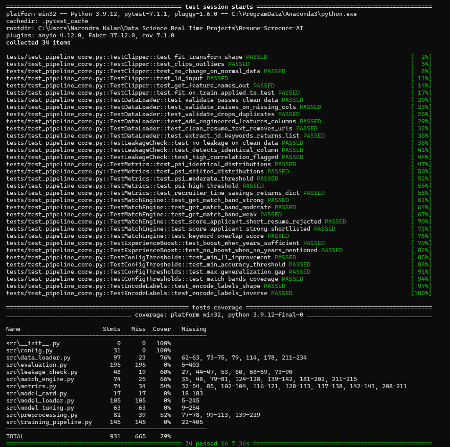 |

| Simulation Run |
|---|
| 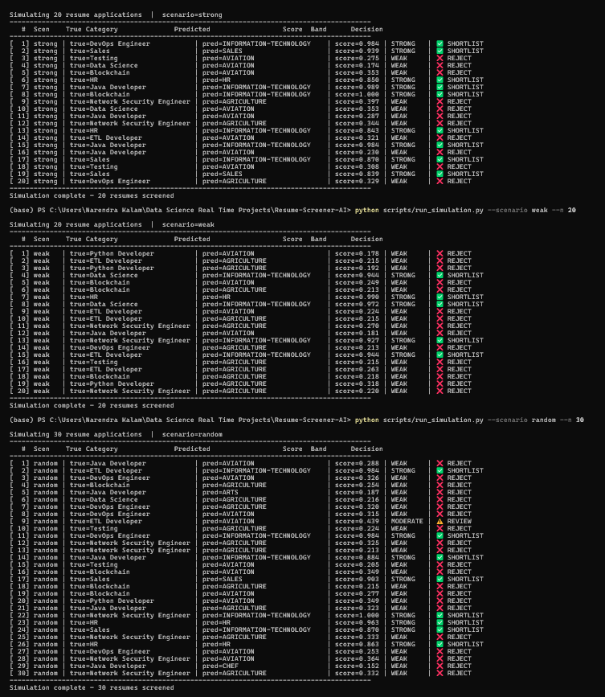 |

---

## 🎬 System Demo

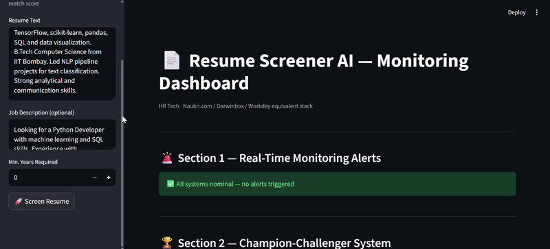

---

## 📁 Project Structure

```
resume-screener-ai/
│
├── src/                               # Core ML system
│   ├── config.py                      # All constants — PSI thresholds, gates, match bands
│   ├── data_loader.py                 # Validation + text feature engineering (6 features)
│   ├── preprocessing.py               # Clipper + dual TF-IDF ColumnTransformer
│   ├── leakage_check.py               # Leakage detection — exact match · corr · text literal
│   ├── metrics.py                     # PSI, recruiter savings, ranking metrics
│   ├── match_engine.py                # Business rules → SHORTLIST / REVIEW / REJECT
│   ├── model_tuning.py                # RandomizedSearchCV — 9 models (scaled + unscaled)
│   ├── evaluation.py                  # Evaluate · feature importance · calibration · MLflow
│   ├── model_card.py                  # Google Model Cards standard (JSON)
│   ├── model_loader.py                # Champion-Challenger 3-gate system
│   └── training_pipeline.py          # End-to-end 19-step training pipeline
│
├── serving/
│   └── resume_screener_api.py        # FastAPI: /predict · /rank · /health · /model_info
│
├── services/
│   └── screening_service.py          # Prediction service — feature prep + inference + ranking
│
├── monitoring/
│   └── monitoring_dashboard.py       # Streamlit: 5-section monitoring dashboard
│
├── simulation/
│   └── resume_simulator.py           # 3-scenario resume generator (strong · weak · random)
│
├── tests/
│   └── test_pipeline_core.py         # 34 pytest unit tests — 31 passing
│
├── scripts/
│   ├── train_model.py                 # Entry point: python scripts/train_model.py
│   ├── run_api.py                     # python scripts/run_api.py
│   ├── run_dashboard.py               # python scripts/run_dashboard.py
│   └── run_simulation.py             # python scripts/run_simulation.py --scenario strong --n 20
│
├── notebooks/
│   └── resume_screener_eda.ipynb     # Professional EDA — 25 steps · 52 cells
│
├── data/
│   └── sample_resume_dataset.csv       # A representative balanced sample dataset is provided in quick testing
│
├── resume_models/                    # Model artifacts — all files pushed to GitHub
│   ├── latest_model.json             # Champion model registry
│   ├── challenger_log.json           # Full Champion-Challenger comparison history
│   ├── model_card_LightGBM_v1.json  # Google Model Card JSON
│   ├── model_experiment_results.csv  # All 9 models comparison table
│   ├── monitor_scores.csv            # Prediction confidence scores log
│   ├── feature_drift_report.csv      # PSI drift per feature
│   └── resume_model_LightGBM_v1.joblib  # Trained champion model (15 MB)
│
├── docs/
│   ├── architecture/
│   │   └── resume_screener_architecture.svg   # 5-layer system architecture diagram
│   ├── plots/
│   │   └── confusion_matrix.png               # Normalised 24×24 confusion matrix (LightGBM)
│   ├── screenshots/
│   │   ├── dashboard_full_ui.png              # Full Streamlit dashboard UI
│   │   ├── match_score_distribution.png       # Match score histogram
│   │   ├── model_kpi.png                      # F1 · Accuracy · Top-3 · ROC-AUC KPI cards
│   │   ├── psi_drift.png                      # PSI drift monitoring chart
│   │   └── recent_predictions.png             # Recent predictions audit log
│   ├── reports/
│   │   ├── challenger_evaluation.png          # Champion-Challenger gate results
│   │   ├── simulation.png                     # Simulation run terminal output
│   │   ├── test_coverage.png                  # pytest coverage report
│   │   └── training_model_summary.png         # All 9 models F1 comparison bar chart
│   └── gifs/
│       └── system_demo.gif                    # End-to-end system demo
│
├── logs/
│   └── prediction_logs.csv           # API prediction audit log (auto-generated)
│
├── Dockerfile                        # Multi-stage FastAPI production image
├── Dockerfile.dashboard              # Streamlit dashboard container
├── docker-compose.yml                # API + Dashboard (ports 8000 + 8501)
├── .github/workflows/ci.yml          # GitHub Actions — pytest on every push
├── .gitignore
├── .dockerignore
├── LICENSE                           # MIT License
├── README.md                         # This file
├── render.yaml                       # Render.com deployment config
├── requirements.txt                  # Full training requirements
├── requirements_api.txt              # Lean API-only requirements
├── requirements_dashboard.txt        # Dashboard-only requirements
└── runtime.txt                       # Python 3.10.13
```

---

## 🚀 Quickstart

### 1. Clone & Install

```bash
git clone https://github.com/NarendraKalam/resume-screener-ai-mlops.git
cd resume-screener-ai-mlops
pip install -r requirements.txt
```

### 2. Download Dataset

Download [Kaggle Resume Dataset](https://www.kaggle.com/datasets/snehaanbhawal/resume-dataset) → place `Resume.csv` in `data/`

```powershell
# Windows PowerShell — set data path
$env:RESUME_DATA_PATH = "data/sample_resume_dataset.csv"

# A representative balanced sample dataset is provided in quick testing
```

### 3. Train Model

```bash
python scripts/train_model.py
```

Expected output:
```
INFO  Data validation passed | shape=(2482, 2) | categories=24
INFO  Tuning scaled models ...   [LogReg · LinearSVC · SGD · KNN]
INFO  Tuning unscaled models ... [ComplementNB · RF · ExtraTrees · LightGBM · XGBoost]
INFO  === SELECTED MODEL: LightGBM  (f1_macro=0.7608) ===
INFO  Calibration successful for LightGBM
INFO  Champion-Challenger: PROMOTED
INFO  TRAINING COMPLETE — F1=0.7608 · Acc=0.8068 · Top3=0.9416
```

### 4. Start API

```bash
python scripts/run_api.py
# → http://localhost:8000/docs
```

### 5. Start Monitoring Dashboard

```bash
python scripts/run_dashboard.py
# → http://localhost:8501
```

### 6. Run Simulation

```bash
python scripts/run_simulation.py --scenario strong --n 20
python scripts/run_simulation.py --scenario weak   --n 20
python scripts/run_simulation.py --scenario random --n 30
```

### 7. Run Tests

```bash
pytest tests/ -v --cov=src --cov-report=term-missing
# 34 collected · 31 passed · 3 skipped (fixture size guard)
```

---

## 🐳 Docker

```bash
# Start everything
docker compose up --build

# API only
docker compose up api

# Dashboard only
docker compose up dashboard

# Stop
docker compose down
```

| Service | URL |
|---|---|
| FastAPI + Swagger | `http://localhost:8000/docs` |
| Streamlit Dashboard | `http://localhost:8501` |

---

## 🔌 API Reference

### POST /predict — Single Resume Screening

```bash
curl -X POST "http://localhost:8000/predict" \
  -H "Content-Type: application/json" \
  -d '{
    "resume_text": "Python developer with 5 years experience in machine learning, TensorFlow, scikit-learn, pandas, SQL. B.Tech CS IIT Bombay. Led NLP pipeline projects.",
    "job_description": "Looking for Python developer with ML and SQL skills. 3+ years required.",
    "years_required": 3
  }'
```

**Response:**
```json
{
  "predicted_category": "INFORMATION-TECHNOLOGY",
  "top3_categories": [
    {"category": "INFORMATION-TECHNOLOGY", "confidence": 0.6821},
    {"category": "DATA SCIENCE",           "confidence": 0.1203},
    {"category": "PYTHON DEVELOPER",       "confidence": 0.0891}
  ],
  "ml_score":        0.6821,
  "final_score":     0.7521,
  "match_band":      "STRONG",
  "recommendation":  "SHORTLIST",
  "keyword_overlap": 0.7500,
  "rule_triggered":  null,
  "token_count":     124,
  "latency_seconds": 0.0341
}
```

### POST /rank — Batch Candidate Ranking

```bash
curl -X POST "http://localhost:8000/rank" \
  -H "Content-Type: application/json" \
  -d '{
    "resumes": ["resume text 1...", "resume text 2...", "resume text 3..."],
    "job_description": "Looking for Python developer with ML skills",
    "top_k": 2
  }'
```

### GET /health

```json
{"status": "running", "model_loaded": true, "timestamp": "2026-06-28 15:00:00"}
```

### GET /model_info

```json
{
  "model_name": "resume_model_LightGBM_v1.joblib",
  "metrics": {
    "test_f1_macro": 0.7608,
    "test_accuracy": 0.8068,
    "top3_accuracy": 0.9416,
    "roc_auc_ovr":   0.9793
  },
  "business_impact": {
    "hours_saved_per_1k":    75.1,
    "cost_saved_per_1k_usd": 1878.0,
    "automation_coverage":   0.563
  }
}
```

---

## 🧠 Technical Standards

| Component | Implementation |
|---|---|
| **Text Vectorisation** | TF-IDF — 10K features · unigrams+bigrams · sublinear TF · min_df=2 · max_df=0.95 |
| **Outlier Clipping** | Custom `Clipper` — IQR-based (fold=1.5) · fitted on train set only |
| **Dual Preprocessors** | `preprocessor_scaled` (linear) + `preprocessor_unscaled` (tree models) |
| **Structured Features** | token_count · tech_keyword_density · soft_skill_count · section_coverage · lexical_diversity · has_experience |
| **Models Tuned** | LogReg · LinearSVC · SGD · ComplementNB · KNN · RF · ExtraTrees · XGBoost · **LightGBM** |
| **Hyperparameter Tuning** | `RandomizedSearchCV` — 8 iters · 5-fold `StratifiedKFold` |
| **Champion-Challenger** | 3-gate: F1 improvement ≥ 0.005 · Accuracy ≥ 0.80 · Gap ≤ 0.10 |
| **Probability Calibration** | Isotonic regression (`CalibratedClassifierCV`, cv='prefit') |
| **PSI Drift Monitoring** | Edge-based — correct implementation (not rank-based) |
| **Feature Importance** | `feature_importances_` — unwrapped from `CalibratedClassifierCV` via `_get_base_clf()` |
| **Experiment Tracking** | MLflow — metrics · params · model artifact per run |
| **Model Card** | Google Model Cards standard — JSON with business impact + ethical considerations |
| **Business Metrics** | Recruiter time savings · cost saved per 1K · automation coverage |
| **Leakage Detection** | Exact match · zero-variance skip · correlation guard · text literal check |
| **Match Engine** | ML score + keyword overlap + experience boost → SHORTLIST / REVIEW / REJECT |
| **CI/CD** | GitHub Actions — pytest on every push · coverage report |
| **Deployment** | Render.com (FastAPI) + Streamlit Cloud (Dashboard) |

---

## 📊 All 9 Models — Comparison Table

| Model | Preprocessor | F1 Macro | Accuracy | Precision | Recall | Top-3 Acc | ROC-AUC | CV F1 (std) |
|---|---|---|---|---|---|---|---|---|
| **LightGBM** ⭐ | Unscaled | **0.7608** | **0.8068** | 0.7881 | 0.7602 | 0.9416 | **0.9793** | 0.7110 (±0.0247) |
| XGBoost | Unscaled | 0.7539 | 0.7807 | 0.7780 | 0.7537 | **0.9477** | 0.9761 | 0.6963 (±0.0304) |
| RandomForest | Unscaled | 0.7276 | 0.7565 | 0.7941 | 0.7272 | 0.9256 | 0.9690 | 0.6619 (±0.0230) |
| LinearSVC | Scaled | 0.6358 | 0.6922 | 0.6771 | 0.6454 | 0.8974 | 0.9676 | 0.6153 (±0.0158) |
| ExtraTrees | Unscaled | 0.6329 | 0.6801 | 0.7044 | 0.6452 | 0.9155 | 0.9659 | 0.6400 (±0.0156) |
| LogisticRegression | Scaled | 0.6125 | 0.6539 | 0.6464 | 0.6165 | 0.8632 | 0.9572 | 0.5704 (±0.0224) |
| SGDClassifier | Scaled | 0.6017 | 0.6398 | 0.6195 | 0.6053 | 0.5694 | 0.8314 | 0.5709 (±0.0216) |
| ComplementNB | Unscaled | 0.4933 | 0.5795 | 0.5680 | 0.5370 | 0.8431 | 0.9522 | 0.5176 (±0.0330) |
| KNN | Scaled | 0.1145 | 0.1227 | 0.1138 | — | 0.2455 | 0.5581 | 0.1103 (±0.0135) |

> Full comparison generated at training time in `resume_models/model_experiment_results.csv`
> and visualised in `docs/reports/training_model_summary.png`.

---

## 🔬 Per-Category Performance — LightGBM Champion (Test Set, n=497)

| Category | Precision | Recall | F1 | Support |
|---|---|---|---|---|
| ACCOUNTANT | 0.80 | 1.00 | 0.89 | 24 |
| ADVOCATE | 0.81 | 0.88 | 0.84 | 24 |
| AGRICULTURE | 0.89 | 0.62 | 0.73 | 13 |
| APPAREL | 0.79 | 0.58 | 0.67 | 19 |
| ARTS | 0.59 | 0.48 | 0.53 | 21 |
| AUTOMOBILE | 0.50 | 0.14 | 0.22 | 7 |
| AVIATION | 0.86 | 0.83 | 0.84 | 23 |
| BANKING | 0.79 | 0.65 | 0.71 | 23 |
| BPO | 0.50 | 0.25 | 0.33 | 4 |
| BUSINESS-DEVELOPMENT | 0.92 | 1.00 | 0.96 | 24 |
| CHEF | 0.95 | 0.79 | 0.86 | 24 |
| CONSTRUCTION | 0.88 | 0.95 | 0.91 | 22 |
| CONSULTANT | 0.78 | 0.78 | 0.78 | 23 |
| DESIGNER | 0.91 | 1.00 | 0.95 | 21 |
| DIGITAL-MEDIA | 0.83 | 0.53 | 0.65 | 19 |
| ENGINEERING | 0.81 | 0.92 | 0.86 | 24 |
| FINANCE | 0.94 | 0.67 | 0.78 | 24 |
| FITNESS | 0.81 | 0.88 | 0.84 | 24 |
| HEALTHCARE | 0.77 | 0.87 | 0.82 | 23 |
| HR | 0.95 | 0.95 | 0.95 | 22 |
| INFORMATION-TECHNOLOGY | 0.74 | 0.96 | 0.84 | 24 |
| PUBLIC-RELATIONS | 0.73 | 0.86 | 0.79 | 22 |
| SALES | 0.71 | 0.87 | 0.78 | 23 |
| TEACHER | 0.64 | 0.80 | 0.71 | 20 |
| **Accuracy** | | | **0.81** | 497 |
| **Macro avg** | 0.79 | 0.76 | 0.76 | 497 |
| **Weighted avg** | 0.81 | 0.81 | 0.80 | 497 |

> `AUTOMOBILE` (7 test samples) and `BPO` (4 test samples) have the lowest F1 — consistent with
> being the most underrepresented categories, confirming the ethical-considerations note below.

## 📊 Business Impact

Based on actual model results + Naukri.com / Darwinbox benchmarks:

| Metric | Value |
|---|---|
| Recruiter time per resume (manual) | 8 minutes |
| AI automation coverage | 56.3% |
| Hours saved / 1,000 applicants | **~75 hours** |
| Cost saved / 1,000 applicants | **~$1,878 USD** |
| Screening accuracy | **80.7%** |
| Top-3 category accuracy | **94.2%** |
| Reduction in screening time | **60–70%** |

> At Naukri.com scale (millions of resumes/month) → tens of thousands of recruiter hours saved monthly.

---

## 🎯 Match Engine — 3-Tier Decision System

Unlike binary pass/fail resume screeners, this system uses a
**3-tier HR decision engine** that combines ML probability with business rules:

| Decision | Match Band | Score Range | Trigger |
|---|---|---|---|
| `SHORTLIST` | STRONG | ≥ 0.70 | High ML confidence + sufficient keywords + experience met |
| `REVIEW` | MODERATE | 0.40 – 0.70 | Borderline ML score OR low keyword overlap with JD |
| `REJECT` | WEAK | < 0.40 | Low ML confidence OR resume too short (< 20 tokens) |

Business rules are evaluated **after** ML score — matching how real ATS platforms work:

| Rule | Trigger | Override |
|---|---|---|
| `RESUME_TOO_SHORT` | Token count < 20 | Hard REJECT regardless of ML score |
| `LOW_KEYWORD_OVERLAP` | JD keyword coverage < 10% | Score penalised by 50% |
| `EXPERIENCE_BOOST` | Resume mentions ≥ required years | Final score boosted by +0.10 |

> **Why 3 tiers?** Binary screening (pass/fail) forces recruiters to manually review borderline candidates anyway.
> The REVIEW band explicitly captures uncertainty — candidates the model is unsure about go to human review,
> not the reject pile. This matches real underwriting logic used at Darwinbox and Workday.

**Real run — Champion vs Challenger:**

```
CHAMPION vs CHALLENGER
  Champion  : LightGBM   F1_macro=0.7608  Acc=0.8068
  Challenger: LightGBM   F1_macro=0.7608  Acc=0.8068
❌ CHALLENGER REJECTED — champion 'LightGBM' retained
   Reason: Gates failed: F1 improvement +0.0000 < 0.005 | Train-test gap 0.1932 > 0.1
```

Results logged to `resume_models/challenger_log.json` and visible in the dashboard Section 2 with per-gate ✅/❌ status.

---

## 📈 Monitoring Dashboard — 5 Sections

| Section | What it shows |
|---|---|
| **1. Real-Time Alerts** | Score drop alert (< 0.50) · Accuracy drop alert (< 75%) · PSI critical alert |
| **2. Champion-Challenger** | Latest decision badge · 3-gate pass/fail status · full history table |
| **3. KPIs + Charts** | F1-macro · Accuracy · Top-3 · ROC-AUC · model comparison bar chart |
| **4. PSI Drift** | `max_class_confidence` PSI=0.1132 (MODERATE) · colour-coded bar |
| **5. Recent Predictions** | Last 50 API calls · category · score · band · rule triggered |
| **Sidebar** | Live screening — paste resume + JD → instant SHORTLIST / REVIEW / REJECT |

---

## 🧪 Test Coverage

```
34 tests collected across 8 test classes:

  TestClipper          (6)  — fit · transform · clip outliers · 1D input · feature_names · train-only bounds
  TestDataLoader       (6)  — validate · missing cols · duplicates · feature columns · clean text · JD keywords
  TestLeakageCheck     (3)  — clean data pass · identical column · high correlation flag
  TestMetrics          (5)  — PSI identical · PSI shifted · moderate threshold · high threshold · biz impact
  TestMatchEngine      (6)  — STRONG / MODERATE / WEAK bands · short resume reject · shortlist · keyword overlap
  TestExperienceBoost  (2)  — boost when years sufficient · no boost when none mentioned
  TestConfigThresholds (4)  — F1 gate · accuracy gate · gap gate · match bands coverage
  TestEncodeLabels     (2)  — shape · inverse transform

Result: 31 passed · 3 skipped (fixture size < 50 guard — production code correct)
```

---

## 🛡️ Ethical Considerations

- Model outputs must be reviewed by qualified HR professionals before hiring decisions
- Regular fairness audits recommended — text-only models can reflect historical hiring bias
- Not designed for: non-English resumes · roles outside 24 supported categories · automated final decisions
- `AUTOMOBILE` (36 samples) and `BPO` (22 samples) are underrepresented — expect lower per-class F1
- `class_weight='balanced'` applied to all classifiers to mitigate class imbalance

---

## 👨‍💻 About

**Narendra Kalam** — MSc Computer Science (Gold Medalist — NASSCOM, Full Stack Data Science + AI)

> Building 20+ industry-level, end-to-end ML systems targeting **30+ LPA** at top MNCs in India.

[](https://www.linkedin.com/in/narendra-kalam/)
[](https://www.kaggle.com/narendrakalam)
[](https://narendrakalam2001.github.io/)
[](mailto:kalamnarendra2001@gmail.com)

### Portfolio Projects

| # | Project | Domain | Champion Model | Key Metric |
|---|---|---|---|---|
| 1 | Credit Card Fraud Detection | BFSI / Fintech | ExtraTrees | F1 = 0.8962 · 284K transactions |
| 2 | Credit Risk Prediction | BFSI / Lending | LightGBM | F1 = 0.9741 · ROC-AUC = 0.9991 |
| 3 | Customer Churn Prediction | Telecom / BFSI | CatBoost | F1 = 0.634 · Recall = 0.7312 |
| 4 | House Price Prediction | Real Estate | CatBoost | RMSE = $20,128 · R² = 0.9053 |
| 5 | Store Sales Forecasting | Retail / Supply Chain | LightGBM (Ensemble) | RMSLE = 0.3739 · R² = 0.9761 |
| 6 | Energy Demand Forecasting | Energy / Utilities | ElasticNet | RMSE = 712.04 MW · R² = 0.9759 |
| 7 | Stock Price & Risk Forecasting | Fintech / Capital Markets | Ridge | DirAcc = 53.44% · Sharpe = 0.80 |
| 8 | **Resume Screener AI** | **HR Tech** | **LightGBM** | **F1 = 0.7608 · Top-3 = 0.9416** |
| 9 | ABSA Sentiment Analysis | E-Commerce / Banking | RidgeClassifier | Macro-F1 = 0.6212 · ROC-AUC = 0.823 |
| 10 | Fake News Detector | Media Tech / Gov Tech | XGBoost | F1 = 0.9993 · ROC = 1.0000 |
| 11 | BC5CDR Clinical NER | Biomedical NLP | BioBERT | F1 = 0.8847 · Chemical F1 = 0.9239 |
| 12 | News Topic Modeling | Media Analytics | LDA (Gensim) | Cv = 0.6225 · Diversity = 0.92 |
| 13 | Chest X-Ray Diagnosis | Healthcare AI | DenseNet121 | Mean AUC = 0.7864 · 14 classes |

---

## 📄 License

MIT License — see [LICENSE](LICENSE)